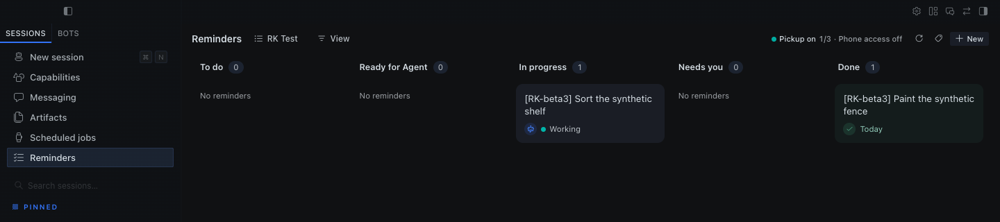

# Hermes Reminders Kanban

Apple Reminders as a Kanban board inside Hermes Desktop. Keep personal tasks and delegated work together, with changes saved back to Reminders.



The board in an isolated Hermes Desktop session, reading a real Reminders test list. One delegated task is running as a Hermes scheduled job and one accepted task is checked off in Reminders. The agent in this capture is a scripted test model.

The board has To do, Ready for Agent, In progress, Needs you, and Done columns. You can edit titles, notes, due dates, priorities, and lists. Filters separate personal and delegated tasks, and recurring and one-off reminders. Title labels such as `[Agent · Ready]` are editable text markers, not native Reminders tags.

## Experimental preview

This is an experimental macOS preview for developers and early testers. Fresh-account setup is not yet verified. It requires macOS 14 or later, Xcode command-line tools, and Hermes Desktop. The helper is compiled locally and needs a persistent local code-signing identity and your Reminders permission. **Set up Reminders access** starts that local setup after your click and retains macOS consent prompts.

Reminder browsing and editing use the native EventKit helper. Delegated work uses only public Hermes plugin interfaces. Each run is a Hermes scheduled job that the plugin creates for that run and removes afterwards, and the agent hands its result or question back through two plugin tools (`reminders_kanban_finish`, `reminders_kanban_ask`). Hermes runs it unattended under its own approval rules for scheduled jobs, on the profile's main model.

The plugin supports questions, result review, retry, task links, and delegation for one occurrence or each due occurrence. Fresh-account setup and cross-device task links remain release checks.

## Install

Requires Hermes 0.23.1 or later. Install from the Hermes plugin catalog:

```sh
hermes plugins install reminders-kanban --enable
```

Read the [installation guide](docs/installation.md) for prerequisites, local helper setup, and host compatibility. To install straight from GitHub, use the pinned command in the release notes. The installable package is the `plugin/` subdirectory of this repository; the repository root contains editable source and development dependencies.

## Data and background work

You choose the Reminders lists shown on the board. Human tasks are not eligible for agent pickup. Explicit delegation and activation authorize new work. Existing Ready labels appear in the setup preview before pickup is enabled.

The plugin stores task bindings, settings, and its task store in the local Hermes profile (`reminders-kanban/`). It uses a native helper to read and write Apple Reminders. Reminders may sync through your Apple account. Delegated task content goes to Hermes and its configured model provider. While a delegated task runs, it appears as a scheduled job named `Reminders: <task>` in Hermes; the plugin removes the job when the run ends. The plugin adds no separate hosted service or telemetry endpoint. It runs local Swift compilation, code signing, and helper launches. Task-link setup checks the dashboard and installed Tailscale status. An explicit setup action can set dashboard.public_url through the Hermes CLI or add a private Tailscale Serve route. Undo stores only the previous URL, not a copy of Hermes configuration. Local helper commands receive a minimal environment without inherited provider credentials.

While enabled in a running gateway, the plugin checks work in the background every five seconds. One profile owner performs the passes. Turning pickup off stops new automatic starts while existing work can still be observed and reviewed. Disabling the plugin stops its background timer. Closing the board does not stop the gateway.

Local task review does not require a public address. Cross-device task links require your own reachable, authenticated HTTPS Hermes dashboard. The plugin does not provision public hosting. Links contain task identifiers, not authentication tokens.

## Limits

- Hermes is the only execution agent. Per-task agent or model selection is not supported; runs use the profile's main model.
- Scheduled jobs follow Hermes' `approvals.cron_mode`. With the default, a run that needs an approval-gated command is refused that command.
- Repeat schedules, subtasks, and attachments are edited in Apple Reminders.
- An accepted result completes the reminder. Finishing agent work alone does not mark it complete.
- A running, compatible owning gateway is required for background work. Opening a task link on another device does not transfer execution.
- Use one execution Mac during this preview. Two independent Macs can briefly start the same reminder before iCloud syncs their claims. A claim write can also conflict with a phone note edit that has not synced yet. Real iCloud coordination remains unverified.
- Permission denial, an unavailable helper, or Hermes refusing scheduled jobs needs attention before affected operations can continue.

Read the [development guide](docs/development.md) to build, test, and reproduce the installable package. The project uses the [MIT license](LICENSE), with [third-party notices](THIRD_PARTY_NOTICES.md) for adapted icons.
